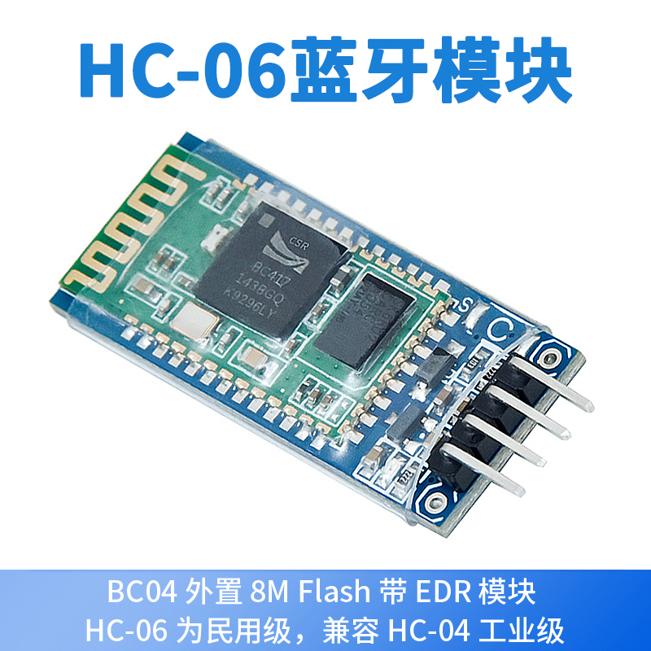

# SKU MD0587｜HC-06 蓝牙串口兼容模块

## 产品图片




## 产品概述

本产品为 **HC-06 蓝牙串口兼容模块**，用于在支持经典蓝牙串口通信的设备与微控制器之间建立无线 UART 数据链路。模块可用于无线串口调试、参数传输和遥控实验。HC-06 类产品通常用于 Bluetooth-to-UART 透传，不应按 BLE 低功耗蓝牙模块使用。[3]

> **包装区分：**MD0587 为模块单品版，MD0621 为含线版。两者主体模块用途相同，差异在于包装是否包含连接线。

## 已确认规格与边界

| 项目 | 资料 |
|---|---|
| SKU | MD0587 |
| 产品名称 | HC-06 蓝牙串口兼容模块 |
| 无线类型 | Bluetooth Classic 2.0 + EDR 兼容（依据用户提供规格长图） |
| 工作频段 | 2.4 GHz ISM 频段（依据用户提供规格长图） |
| 调制方式 | GFSK（依据用户提供规格长图） |
| 通信接口 | UART 串口；TXD 输出、RXD 输入 |
| 逻辑接口 | 以 3.3 V UART 逻辑进行连接；与 5 V 控制器连接时需核对 RXD 电平匹配 |
| 默认角色 | 常见 HC-06 用作从机透传；兼容固件功能仍以实物批次为准 |
| 包装 | 模块单品版本；不包含 SKU 名称中未注明的连接线 |

Olimex 的裸 HC-06 模块资料列出 3.1–4.2 V 工作电压，但用户图片中的产品是带底板兼容板。**裸模块电压不能直接等同于成品底板 VCC 允许范围**，因此本文不把底板供电写成固定 3.3 V 或 5 V，必须以 PCB 丝印及供应商批次规格为准。[3]

## 工作原理

控制器通过 UART 的 TX/RX 与 HC-06 交换字节；蓝牙端与手机或电脑配对后，模块把无线收到的数据送到 UART TXD，也把 UART RXD 收到的数据通过蓝牙发出。UART 是双线全双工接口，接线必须交叉：模块 TXD 接控制器 RX，模块 RXD 接控制器 TX。[1] [2]

## ESP32 测试接线

以下代码面向 **经典 ESP32 DevKit**。如果使用 ESP32-C3、ESP32-S3 或其他引脚布局不同的开发板，应根据板卡引脚图修改代码，不可机械照抄。

| HC-06 兼容板 | ESP32 DevKit | 说明 |
|---|---|---|
| VCC | 按模块底板丝印选择电源 | 先确认底板供电要求，再通电 |
| GND | GND | 必须共地 |
| TXD | GPIO16（ESP32 RX） | 模块发送、ESP32 接收 |
| RXD | GPIO17（ESP32 TX） | ESP32 发送、模块接收 |

不同兼容板的引脚顺序、稳压电路和丝印位置可能不同。接线前必须读取 PCB 丝印，不能仅凭模块朝向判断针脚。


<!-- EMBEDDED_TEST_CODE_START -->

## 完整测试代码（文档内可直接复制）


### Arduino ESP32 完整代码


```cpp
/*
 * MD0587 - HC-06 兼容蓝牙串口模块透传测试
 * 平台：经典 ESP32 DevKit（Arduino 框架）
 * 第三方库：不需要
 *
 * 接线：
 *   HC-06 TXD -> ESP32 GPIO16（RX）
 *   HC-06 RXD <- ESP32 GPIO17（TX）
 *   GND        -> ESP32 GND
 *   VCC        -> 按模块底板丝印/供应批次要求供电
 */

#include <Arduino.h>

HardwareSerial HC06(2);

constexpr int HC06_RX_PIN = 16;
constexpr int HC06_TX_PIN = 17;
// 9600 仅作为首次测试值。若无输出或乱码，请按文档修改并逐一验证常见速率。
constexpr uint32_t HC06_BAUD = 9600;
constexpr uint32_t USB_BAUD = 115200;

void setup() {
  Serial.begin(USB_BAUD);
  delay(300);
  HC06.begin(HC06_BAUD, SERIAL_8N1, HC06_RX_PIN, HC06_TX_PIN);

}

void loop() {
  while (Serial.available() > 0) {
    HC06.write(Serial.read());
  }

  while (HC06.available() > 0) {
    Serial.write(HC06.read());
  }

  delay(1);
}
```

### MicroPython 完整代码

以下程序每秒向蓝牙端发送一行测试文本，并在 MicroPython 控制台打印收到的数据。可下载源文件仍保存在 `code/micropython_esp32/main.py`。

```python
"""
MD0587 - HC-06 兼容蓝牙串口模块收发测试
平台：经典 ESP32 DevKit + MicroPython
第三方库：不需要

接线：
  HC-06 TXD -> ESP32 GPIO16（RX）
  HC-06 RXD <- ESP32 GPIO17（TX）
  GND        -> ESP32 GND
  VCC        -> 按模块底板丝印/供应批次要求供电
"""

from machine import UART
import time

RX_PIN = 16
TX_PIN = 17
# 9600 仅作为首次测试值；如无输出或乱码，请按文档调整。
HC06_BAUD = 9600

bluetooth_uart = UART(
    2,
    baudrate=HC06_BAUD,
    bits=8,
    parity=None,
    stop=1,
    rx=RX_PIN,
    tx=TX_PIN,
)

counter = 0
print("HC-06 UART test started at", HC06_BAUD, "baud")
print("Incoming Bluetooth data will be printed in the MicroPython console.")

while True:
    message = "ESP32 HC-06 test {}\r\n".format(counter)
    bluetooth_uart.write(message)

    time.sleep_ms(200)
    if bluetooth_uart.any():
        received = bluetooth_uart.read()
        print("RX:", received)

    counter += 1
    time.sleep_ms(800)
```

<!-- EMBEDDED_TEST_CODE_END -->

## Arduino ESP32 测试步骤

### 1. 上传串口桥程序

打开 `code/arduino_esp32/MD0587_hc06_uart_bridge.ino`，选择实际使用的 ESP32 开发板和串口，核对接线后编译上传。程序使用 `Serial` 作为 USB 调试串口，速率为 **115200 baud**；使用 `HardwareSerial(2)` 连接模块。

### 2. 首次波特率设置

代码中的 `HC06_BAUD = 9600` 只是首次测试值，不代表所有兼容批次都固定为 9600。默认名称、配对密码、UART 波特率和 AT 指令格式都可能随固件变化。若无响应或乱码，应先确认供应商批次资料；没有资料时，再修改 `HC06_BAUD` 逐一验证其他常见标准速率，每次修改后重新上传。

| 测试现象 | 判断 |
|---|---|
| 蓝牙端发送文字，Arduino 串口监视器显示相同内容 | 蓝牙到 UART 接收通道正常 |
| 串口监视器发送文字，蓝牙终端收到相同内容 | UART 到蓝牙发送通道正常 |
| 双向均正常且无乱码 | 基础串口透传测试通过 |

串口监视器的行尾选项会影响发送的换行字符，但不会改变基础透传原理。测试时可先发送简单 ASCII 文本，例如 `hello`。

## MicroPython 测试步骤

MicroPython 的 `machine.UART` 支持设置波特率、数据位、校验位、停止位及 TX/RX 引脚，并通过 `any()`、`read()`、`write()` 进行收发。[2] 将 `code/micropython_esp32/main.py` 上传到 ESP32 根目录运行后，蓝牙终端应周期性收到 `ESP32 HC-06 test` 测试行；从蓝牙终端发回的数据会显示在 MicroPython REPL 中。

本版依据实测使用 `rx=RX_PIN`、`tx=TX_PIN` 直接传入 GPIO 编号。请勿改回 `rx=Pin(RX_PIN)`、`tx=Pin(TX_PIN)`；后者会在本次测试所用固件中触发 UART 初始化错误。

代码同样以 9600 baud 作为首次测试值。如实物批次不同，只修改 `HC06_BAUD`，不要同时随意更换多个参数，以便定位问题。

## 配对与应用兼容性

测试终端必须支持 **Bluetooth Classic 串口类通信**。HC-06 兼容模块通常不是 BLE 设备，因此仅支持 BLE 扫描的应用可能无法发现或连接。模块 LED 的闪烁方式因底板和固件可能不同，不能只凭 LED 状态判定通过；应以实际双向数据收发为准。

默认蓝牙名称和配对密码没有在本批次资料中得到实物验证，本文不写死具体值。若系统要求输入密码，应以标签、供应商批次资料或实测结果为准。

## 常见问题排查

| 现象 | 优先检查 | 处理方法 |
|---|---|---|
| MicroPython 运行时提示 UART 参数错误 | RX/TX 参数是否被 `Pin(...)` 包裹 | 使用修正版的 `rx=RX_PIN`、`tx=TX_PIN`，直接传入 GPIO 编号 |
| 模块完全不上电 | VCC、GND、底板供电要求 | 断电后按 PCB 丝印复核，不要用裸模块电压替代底板规格 |
| 蓝牙设备搜索不到 | 终端是否支持经典蓝牙、模块是否已被其他设备连接 | 使用支持 Bluetooth Classic 串口的终端；断开已有连接后重试 |
| 能配对但没有数据 | TX/RX 接反、未共地、UART 引脚不匹配 | 模块 TXD→GPIO16，模块 RXD←GPIO17，并连接公共 GND |
| 数据乱码 | 两端波特率不一致 | 修改 `HC06_BAUD` 与实物 UART 波特率一致；保持 8N1 |
| 只能单向通信 | 某一路接线或电平不正确 | 分别检查 TXD→RX 与 RXD←TX，两路单独测试 |
| Arduino 编译错误 | ESP32 板卡核心未正确选择 | 选择已安装的 ESP32 开发板核心；本代码不要求额外 HC-06 库 |
| MicroPython 无输出 | UART ID/引脚与板卡不兼容 | 本示例面向经典 ESP32 DevKit；按实际板卡修改 UART 和 GPIO |

## 关于 AT 指令

本批次没有完成实物固件识别，因此未附带“修改名称、密码或波特率”的 AT 配置程序。兼容固件可能使用不同的 AT 模式进入条件、命令格式、行尾要求和响应文本。在没有确认固件版本前直接批量发送 AT 指令，可能造成配置与资料不一致。建议先完成透明串口收发测试，再依据供应商提供的该批次指令集进行配置。


## 资料核对边界

产品名称、包装差异、无线制式、频段、调制方式和 UART 属性来自用户提供的清单与产品长图；代码 API 和 UART 行为按 Espressif、MicroPython 与 Olimex 资料交叉复核。[1] [2] [3] 底板 VCC 范围、默认名称、配对密码、默认波特率、AT 指令集、LED 状态和连接线具体规格仍需按实物批次确认，因此本文没有将其写成固定承诺。

## References

[1]: https://docs.espressif.com/projects/arduino-esp32/en/latest/api/serial.html "Espressif Arduino-ESP32 — Serial (UART)"
[2]: https://docs.micropython.org/en/latest/library/machine.UART.html "MicroPython documentation — machine.UART"
[3]: https://www.olimex.com/Products/Components/RF/BLUETOOTH-SERIAL-HC-06/ "Olimex — BLUETOOTH-SERIAL-HC-06"
